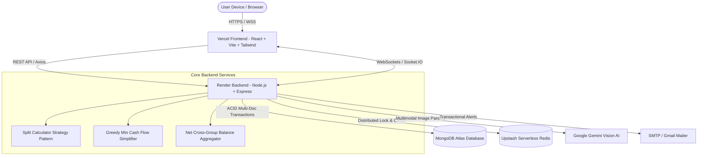

# ✂️ SplitEasy

[](https://split-easy-two.vercel.app/)
[](https://github.com/jangidyash59/SplitEasy)
[](https://split-easy-two.vercel.app/)
[](LICENSE)

> **SplitEasy** is a next-generation, production-ready expense sharing platform built as a modern alternative to Splitwise. It features **Gemini Vision AI receipt scanning**, **Greedy Minimum Cash Flow debt simplification**, **real-time WebSocket updates via Socket.IO**, **Upstash Redis distributed locking**, and an industry-first **Single Point of Net Settlement** that aggregates debts across all shared groups and direct peer splits into one click.

---

## 🌐 Live Application

- **Frontend (Vercel):** [https://split-easy-two.vercel.app/](https://split-easy-two.vercel.app/)
- **Backend API (Render):** `https://spliteasy-backend-3.onrender.com` (or your configured Render URL)
- **Source Code:** [https://github.com/jangidyash59/SplitEasy](https://github.com/jangidyash59/SplitEasy)

---

## 🌟 Key Highlights & Innovations

### 1. ⚡ Single Point of Net Settlement
Traditional expense apps force users to settle debts inside every single group independently (e.g. pay ₹200 in "Trip Group", receive ₹150 in "Flatmates Group", pay ₹50 in a direct split). SplitEasy provides a **unified Friends & Net Settlement dashboard** that computes your absolute mathematical pairwise balance across all groups + individual splits, allowing you to settle everything with a **single click**.

### 2. 🧾 Gemini Vision AI Receipt Scanner
Upload any physical receipt or UPI payment screenshot (Google Pay, PhonePe, Paytm). Google Gemini Multimodal Vision AI automatically analyzes the image, extracts the merchant name, date, tax, line items, and total amount, and pre-fills the expense form in under 3.5 seconds.
- Includes an **intelligent multi-model fallback cascade** (`gemini-3.5-flash`, `gemini-3.1-flash-lite`, `gemini-flash-lite-latest`, `gemini-3.8-flash`) to ensure 99.9% uptime even under free-tier quota spikes.

### 3. 🧠 Greedy Minimum Cash Flow Algorithm
When multiple friends pay for different things inside a group, a tangled web of $N(N-1)/2$ pairwise debts forms. SplitEasy runs an optimized **Greedy Min Cash Flow algorithm** that computes net balances (Creditors vs Debtors) and settles the maximum debtor with the maximum creditor iteratively, reducing transactions down to at most $N-1$.

### 4. 🔌 Real-Time Collaboration (Socket.IO Observer Pattern)
Instant live synchronization across all connected clients. When an expense is recorded or settled by a roommate, your dashboard, group balance, and recent activities update in real-time without refreshing the page.

### 5. 🔒 Distributed Concurrency Locking & ACID Transactions
Financial data demands absolute correctness. SplitEasy combines **Upstash Redis distributed locks (`SET key val NX EX`)** to prevent double-settlement race conditions with **MongoDB multi-document ACID transactions** to ensure atomic ledger updates or total rollbacks.

### 6. 📧 Automated Email Notifications
Instant email confirmation upon debt settlement with full breakdown details delivered to both payer and receiver via SMTP.

---

## 🏗️ System Architecture



---

## 🛠️ Technology Stack

| Layer | Technology | Purpose in SplitEasy |
|---|---|---|
| **Frontend** | React 18, Vite | High-performance SPA with fast HMR and optimized asset bundling |
| **Styling** | Tailwind CSS, Lucide Icons | Responsive, modern dark/light glassmorphic UI |
| **Backend** | Node.js, Express.js | RESTful microservice API and WebSocket server |
| **Database** | MongoDB Atlas, Mongoose | Flexible document model with ACID multi-document transactions |
| **In-Memory Store** | Upstash Redis | Serverless REST-based Redis for distributed locks & caching |
| **AI / Vision** | Google Gemini Vision Flash | Multimodal receipt OCR & payment screenshot parsing |
| **Real-Time** | Socket.IO | Bi-directional WebSocket communication using Observer Pattern |
| **Email Service**| Nodemailer | Transactional email notifications on settlements |
| **Hosting** | Vercel (Frontend), Render (Backend) | Global edge CDN and scalable cloud container hosting |

---

## 📐 Design Patterns Implemented

1. **Strategy Pattern (`splitCalculator.js`):**
   - Encapsulates `EQUAL`, `EXACT`, and `PERCENTAGE` split calculations into interchangeable strategies without nested switch-case bloat.
2. **Observer Pattern (`socket/index.js`):**
   - Socket.IO rooms act as subjects; connected users subscribe to group and personal channels to receive real-time updates when expenses or settlements occur.
3. **Distributed Lock Pattern (`redis.js`):**
   - Prevents race conditions during concurrent settlements by acquiring an atomic Redis key with expiration (`NX EX`) before executing monetary operations.
4. **Unit of Work / Transaction Pattern:**
   - Wraps multi-collection ledger adjustments in MongoDB atomic sessions to guarantee all-or-nothing consistency.

---

## 📡 API Reference Overview

### Authentication
- `POST /api/auth/register` — Register a new account
- `POST /api/auth/login` — Authenticate and receive JWT token
- `GET  /api/auth/profile` — Get authenticated user profile

### Groups & Expenses
- `POST /api/groups` — Create a new group
- `GET  /api/groups` — List user's groups
- `GET  /api/groups/:id` — Get group details, members, and simplified debts
- `POST /api/expenses` — Create expense (supports group and individual splits)
- `GET  /api/expenses/recent` — Fetch recent non-settled expenses
- `GET  /api/expenses/friends` — Get unified cross-group net balance per friend
- `GET  /api/expenses/friends/:friendId` — Get itemized breakdown with a specific friend

### Settlements & AI Receipt
- `POST /api/expenses/settle` — 1-click single point net settlement (clears direct + group debts)
- `POST /api/receipt/scan` — Upload receipt/UPI image for Gemini AI parsing

---

## 🚀 Deployment Guide

### 1. Backend Deployment (Render.com)
1. Go to [Render Dashboard](https://dashboard.render.com/) → **New +** → **Web Service**.
2. Connect repository `https://github.com/jangidyash59/SplitEasy`.
3. Set configuration:
   - **Environment:** `Node`
   - **Root Directory:** `backend`
   - **Build Command:** `npm install`
   - **Start Command:** `node server.js`
4. Add environment variables:
   ```env
   NODE_ENV=production
   PORT=5000
   MONGODB_URI=mongodb+srv://<user>:<password>@cluster.mongodb.net/spliteasy
   JWT_SECRET=your_jwt_secret_key
   UPSTASH_REDIS_REST_URL=https://<your-upstash-host>.upstash.io
   UPSTASH_REDIS_REST_TOKEN=your_upstash_redis_token
   GEMINI_API_KEY=your_gemini_api_key
   CLIENT_URL=https://split-easy-two.vercel.app
   ```

### 2. Frontend Deployment (Vercel)
1. Go to [Vercel Dashboard](https://vercel.com/dashboard) → **Add New...** → **Project**.
2. Import `jangidyash59/SplitEasy`.
3. Set **Root Directory** to `frontend`.
4. Add environment variables:
   ```env
   VITE_API_URL=https://your-render-backend-url.onrender.com
   VITE_SOCKET_URL=https://your-render-backend-url.onrender.com
   ```
5. Deploy!

---

## 💻 Local Development Setup

### 1. Clone & Install
```bash
git clone https://github.com/jangidyash59/SplitEasy.git
cd SplitEasy
```

### 2. Configure Backend
```bash
cd backend
cp .env.example .env
npm install
npm run dev
```

### 3. Configure Frontend
```bash
cd ../frontend
cp .env.example .env
npm install
npm run dev
```

Visit `http://localhost:5173` to test the application locally.

---

## 📄 License
This project is licensed under the MIT License — see the [LICENSE](LICENSE) file for details.
